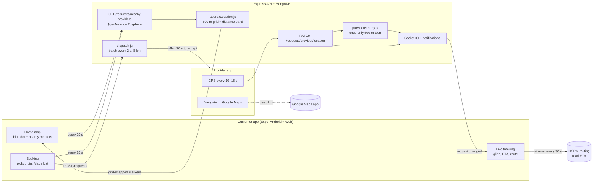

# Maps, nearby providers, dispatch and live tracking

How RapidAssist finds help near a customer in Islamabad and Rawalpindi, shows it on a map without exposing
anyone's exact position, hands the job to a provider, and tracks them to the customer. Every number below is taken
from the code; the file that holds it is named next to it so you can show it in the viva.

## 1. The big picture



## 2. Service area

Requests are only accepted inside Islamabad and Rawalpindi: latitude 33.40–33.80, longitude 72.80–73.30
(`server/src/config/serviceArea.js`; the app keeps an identical copy in `mobile-app/src/config/serviceArea.ts`, and a
test fails if the two ever differ). A pickup outside that box gets a 400 with a clear message, and the booking
screen blocks it before it is sent.

## 3. Finding nearby providers

**Where providers are stored.** Each provider's last GPS fix is in `providerState.currentLocation`, and the same
point as GeoJSON in `providerState.locationPoint`, which has a MongoDB **2dsphere** index (`models/User.js`).

**Who counts as available** (`services/dispatch.js`, `baseEligibleQuery`): a verified provider of the right
service, marked online, not busy on another job, whose location is **fresher than 3 minutes** (`FRESH_MS`). A
provider whose phone stopped reporting drops off the map within 3 minutes.

**The query** (`listNearbyProviders` in `controllers/requests.controller.js`): MongoDB `$geoNear` sorts eligible
providers by distance from the customer's point. Membership then uses the same haversine distance as dispatch, so a
provider shown "within 8 km" is exactly one dispatch could offer the job to.

**Radius expansion vs. dispatch radius.** Dispatch only ever offers jobs within **8 km** (`radiusFor`). If nobody
is inside 8 km, the map search widens to **10, then 20, then 30 km** (`PREVIEW_EXPANSION_KM`) so the customer
still sees the nearest help. The response says so: `radiusKm` (searched), `dispatchRadiusKm` (8) and
`expanded: true`. Seeing a provider 15 km away does not mean they will get the job automatically.

**Ordering.** Up to 20 providers are returned, best first: `distanceScore = max(0, 50 − 3 × km)`, plus
`8 × rating`, plus `min(15, completedJobs / 4)`.

**Refresh.** The app asks again every 20 s while the screen is open, waits 400 ms after the pin stops moving, and
never polls from a screen hidden under another (`useNearbyProviders.ts`).

## 4. Privacy: grid snapping and distance bands

A customer must never learn a provider's exact position before a job is accepted. Two rules
(`services/approxLocation.js`):

1. **`approxLocation` is snapped to a fixed grid** of 0.005° (about 556 m north–south and 463 m east–west here).
   Snapping is **deterministic**: the same provider always lands on the same grid point. Random jitter would not
   work, because asking many times and averaging the jittered points converges on the true position.
2. **Distance is a band, not a number**: "under 2 km", "2–5 km", "5–10 km" or "10+ km". The band (and the list
   order) is computed from the **snapped** point, not the real one. If it used the real distance, someone could move
   their pickup until the band flips from "under 2 km" to "2–5 km". That traces an exact 2 km circle around the
   provider, and three such circles meet at the provider's exact position. Using the snapped point means the band
   reveals nothing the grid point does not already reveal.

Exact coordinates and `distanceKm` are never in the response; `test/nearbyProviders.test.js` fails if they appear.
Request **counts** on the admin heatmap are aggregated the same way, into ~1 km cells inside MongoDB, so no
customer's pickup point is ever sent to the admin panel (`services/requestHeatmap.js`).

**Abuse limits.** Each user may call nearby search 60 times a minute and send 30 location updates a minute; above
that the server answers 429 with a message and a `Retry-After` time, and the app waits it out
(`routes/requests.routes.js`).

## 5. On the map

The same `MapCanvas` component draws every map, with three renderers: react-native-maps on Android (Google key
set), Google Maps JS on web (key set), otherwise an OpenStreetMap tile canvas (WebView or iframe).

- Provider markers have a colour and icon per service: amber spanner (mechanic), pink truck (towing), green pump
  (fuel). They are "ambient": the camera does not chase them on every refresh.
- Tapping a marker opens a card with name, rating ("New provider" if none), jobs done, distance band and
  "about N min" (road ETA from the approximate point). "Request <service>" starts the normal booking; the
  customer cannot pick a specific provider, because dispatch stays automatic.
- The booking screen has a **Map | List** toggle; the list is sorted by distance band, then rating.
- The customer's own position is a blue dot; if the fix is approximate (worse than 100 m) a faint circle shows how
  far off it could be.
- Text that the map documents display is escaped: names arrive as data and are set as text, never as HTML
  (`components/maps/mapHtmlSafety.ts`, with tests that try script injection).

## 6. Dispatch: from request to an accepted job

```mermaid
sequenceDiagram
  participant C as Customer app
  participant S as Server
  participant W as Dispatch worker (every 2 s)
  participant P as Provider app
  C->>S: POST /requests (pickup in service area)
  S-->>C: request "searching_provider"
  loop each batch
    W->>S: eligible providers within 8 km, fresh GPS
    W->>W: assign requests to providers (min-cost)
    W->>P: offer (socket + push), 20 s to accept
  end
  P->>S: PATCH /requests/:id/accept
  S-->>C: "provider_assigned" (socket)
  Note over C,P: no answer in 20 s → offer expires, next batch tries others; after 3 min → "no provider"
```

Every **2 seconds** (`BATCH_WINDOW_MS`) the worker collects all requests still searching and all free, eligible
providers, and solves the assignment for the whole batch at once instead of first-come-first-served. Each pair's
score is (`scoreBreakdown`):

| Component | Weight | Meaning |
|---|---|---|
| Proximity | 45 % | 1 at the pickup, 0 at the 8 km edge |
| Rating | 25 % | Bayesian average (pulled towards 4 for new providers) |
| Experience | 15 % | completed jobs, capped at 100 |
| Response speed | 15 % | how quickly they usually answer offers |

An offer is reserved for one provider for **20 s** (`OFFER_MS`); a database index guarantees a provider never holds
two pending offers. A request stops searching after **3 minutes** (`SEARCH_MS`). An optional smarter solver
(Hungarian algorithm with a multi-objective cost) sits behind `SMART_MATCHING_ENABLED`; see `docs/smart-matching/`.
Demo map providers are excluded from dispatch.

## 7. Live tracking after acceptance

**Provider position.** The provider app sends a GPS fix every 10 s in the foreground and every 15 s in the
background (`DispatchProvider.tsx`, `services/backgroundLocation.ts`). The server rejects a fix older than the one
it holds (out-of-order updates), then tells the customer over Socket.IO that the request changed.

**Smooth marker.** Instead of jumping every 10 s, the provider marker glides to each new point over 0.9 s
(ease-out); jumps over 3 km snap. While updates stay inside the view the camera holds still, so you see the car
move (`components/maps/useGlidingMarkers.ts`, `tileCanvasHtml.ts`).

**"Last known".** If no update arrived for 45 s the marker is labelled "Last known" and the ETA shows "GPS
delayed".

**ETA.** The road route and travel time come from OSRM (`services/routing.ts`), asked at most **once every 30 s**
per trip leg with the newest position (`useThrottledRoute.ts`), on both the customer's and the provider's screen.
If OSRM fails, a straight-line estimate at 30 km/h is shown instead, marked "About" or "~" (`liveEta.ts`).

**"Your provider is nearby".** When an update lands within **500 m** of the pickup while the provider is still on
the way, the customer gets one notification. "Once" is enforced by the database: only the update that changes
`providerNearbyNotifiedAt` from empty sends it, so racing updates or GPS wobble around 500 m cannot repeat it
(`services/providerNearby.js`).

**Navigation for the provider.** "Navigate to pickup" (and "Navigate to drop-off" for towing) opens Google Maps
turn-by-turn through the `google.navigation:` deep link on Android, falling back to the Google Maps web directions
URL (`utils/navigation.ts`).

**Towing.** Once the vehicle is loaded the customer sees the planned pickup → drop-off route dotted, the live
remaining route on top, and Remaining / ETA / Whole trip figures.

## 8. When the network is bad

Map screens keep the last nearby list, show "Offline – showing last update from …", retry after 10, 20, 40 and
80 s and then every 160 s, and retry at once when the connection returns (`nearbyPolling.ts`).

## 9. Questions you may be asked

- **Why not show the exact provider location?** Safety: before acceptance there is no relationship between customer
  and provider. After acceptance, the customer does see the assigned provider live, which is needed to meet them.
- **Why deterministic snapping, not random noise?** Noise can be averaged away over many requests; a fixed grid
  cannot.
- **Why compute the band from the snapped point?** Real-distance bands leak the exact position through repeated
  queries from different pickups (circle intersection).
- **Why can the map show providers further than 8 km?** So the customer sees that help exists; dispatch still only
  offers within 8 km, and the response says when the search was widened.
- **Why batch dispatch every 2 s?** Assigning several requests together avoids greedy choices that leave a later
  customer with nobody nearby.
- **What if OSRM (a free public server) is down?** ETAs fall back to a straight-line estimate and are marked as
  approximate; nothing else depends on it.
