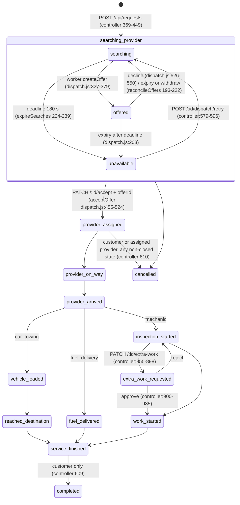

# Smart Matching — Phase 1 Audit

Date: 2026-11-24 · Branch: `fix/provider-location-dispatch-clean` (HEAD `f080f9f`) · Scope: `rapidassist/server/`

All paths below are relative to `rapidassist/server/src/` unless stated otherwise. Line numbers are from the working tree at HEAD.

> **Headline.** The task brief describes an older server. The current server already has a **batch, optimal-assignment dispatcher**: a min-cost-flow solver, targeted offers with a 20 s TTL, decline, expiry, provider reservations, an atomic two-step accept with rollback, a 2 s background worker, a Socket.IO server, a `DispatchOffer` model, recorded response-time and accept/decline metrics, and 178 passing tests that use `mongodb-memory-server`. There is **no** first-come-first-served pool and **no** per-category radius. Section 6 lists every mismatch. Section 7 proposes a design that **extends** the existing engine instead of building a parallel one.

---

## 1. Request lifecycle and status transitions

Statuses: `models/ServiceRequest.js:6-23` (16 values). Dispatch sub-state: `models/ServiceRequest.js:78-90` (`dispatch.state` ∈ `searching | offered | unavailable | assigned | cancelled`, plus `version`, `offerId`, `offeredProviderId`, `expiresAt`, `deadline`, `attemptedProviderIds`, `radiusKm`).

| Transition | Where | Guard |
|---|---|---|
| create → `searching_provider`, `dispatch = newDispatch()` | `controllers/requests.controller.js:405-435`, `services/dispatch.js:162-172` | customer role; idempotent on `clientRequestId` (unique index `ServiceRequest.js:148`) |
| `searching` → `offered` | `dispatch.js:341-363` | conditional on `status`, `providerId:null`, `dispatch.state`, `dispatch.version`, `deadline > now` |
| `offered` → `searching` (decline) | `dispatch.js:528-544` | conditional on `offerId`, `offeredProviderId`, `expiresAt > now` |
| `offered` → `searching`/`unavailable` (expired, provider went offline, lost eligibility) | `dispatch.js:193-222` (`providerStillOwnsOffer` 174-191) | conditional on `offerId` |
| `searching` → `unavailable` | `dispatch.js:224-239` | conditional on `dispatch.version` |
| `unavailable` → `searching` (retry) | `controller:579-596` | owner only, `version` match; keeps historical `radiusKm` |
| → `provider_assigned` | `dispatch.js:455-524` | see §3 |
| job progress | `controller:598-660`, transition table `612-623` | conditional `findOneAndUpdate` on `status`, `providerId`, `dispatch.version` (627-638) |
| extra work | `controller:855-935` | **read-modify-`save()`**, not conditional (see §3) |

Notes:
- `pending`, `in_progress` and `waiting_user_approval` are in the enum. Nothing sets `pending` or `waiting_user_approval`. `in_progress → service_finished` is allowed (controller:621) but nothing enters `in_progress`.
- A provider can cancel an assigned job (controller:603-610). Cancelling closes the request. **It is not re-dispatched.**

## 2. Provider eligibility today

Hard filter: `baseEligibleQuery` + `reservationAvailable` (`dispatch.js:67-94`), then per pair `candidatePairs` (`dispatch.js:303-325`). `exclusionReasons` (`dispatch.js:251-278`) mirrors both for diagnostics.

| Rule | Implementation |
|---|---|
| Role | `roleFilter("mechanic")` (`utils/accountRoles.js`). Supports multi-role accounts. |
| Verified | `verificationStatus: "verified"` |
| Category | `categoryFor`: `car_towing → towing`, others identity (`dispatch.js:18`). Provider categories: `mechanic \| fuel_delivery \| towing` (`models/User.js:8`). |
| Online | `providerState.isOnline: true` |
| Not busy | `providerState.activeRequestId: null` |
| Not reserved | `reservedOfferId` null or `reservedUntil <= now` (one pending offer per provider) |
| Fresh location | `currentLocation.updatedAt` **and** `capturedAt` within `FRESH_MS = 180 s` (`dispatch.js:16`, `62-65`) |
| Not the customer | `dispatch.js:310` |
| Not previously offered this request | `attemptedProviderIds` (`dispatch.js:312`). This covers declined, expired **and** withdrawn offers. |
| Radius | Haversine `≤ request.dispatch.radiusKm`. **`radiusFor = () => 8` for every category** (`dispatch.js:19`). The schema default is 5 (`ServiceRequest.js:89`), used only by legacy documents. In tests only, `DISPATCH_TEST_BYPASS_RADIUS` bypasses the radius (`dispatch.js:28-31`). |
| Pickup usable | `isGoogleLocationExpired` pickups are skipped (`dispatch.js:306`). Google-sourced pickups are refreshed first (`dispatch.js:396-403`). |

Separately, the customer "nearby providers" preview (`controller:509-561`) uses the same `eligibleQuery` and 8 km radius but its own display score (`nearbyProviderScore`, controller:75-82). That score does not affect dispatch.

## 3. Accept / decline / cancel / status flows and race conditions

**There is no open pool.** `GET /open` (`routes/requests.routes.js:32` → `listProviderRequests`, controller:495-507) returns only offers addressed to the caller that have not expired. A provider can accept only with the matching `offerId`.

**Accept** (`acceptOffer`, `dispatch.js:455-524`) is already a two-step conditional claim:
1. Provider claim: `User.findOneAndUpdate({ …eligible, reservedOfferId: offerId, reservedUntil > now }, { activeRequestId: id, claimedAt, clear reservation })` (465-477).
2. Request claim: `ServiceRequest.findOneAndUpdate({ status: searching_provider, providerId: null, dispatch.state: offered, offerId, offeredProviderId, expiresAt > now }, { provider_assigned … })` (482-501).
3. If step 2 fails: it checks whether the request was committed anyway, and otherwise rolls back the provider claim (503-513). A unique partial index `{providerId, assignmentActive:true}` (`ServiceRequest.js:147`) backstops "one active job per provider". `recoverReservations` (`dispatch.js:561-588`) clears claims more than 30 s old that never committed (crash between steps).
4. Tests already cover concurrent accept, cancel racing accept, and claim/expiry interleavings (`test/dispatch.test.js:405-468, 719-743, 880-893`).

**Decline**: one conditional update, then reservation release and offer resolution (`dispatch.js:526-550`).

**Cancel**: conditional on `status` + `providerId` + `dispatch.version` (controller:627-638), then `cancelDispatchOffer` releases any outstanding reservation (controller:640, `dispatch.js:552-559`).

**Remaining real races / weaknesses (flag-independent):**

| # | Issue | Where | Impact |
|---|---|---|---|
| R1 | `requestExtraWork` / `approveExtraWork` load the document, mutate it and `save()` with no status/version condition. A concurrent cancel or status update can be overwritten, for example a cancelled job flipped back to `extra_work_requested`. | controller:858-883, 902-920 | Real lost-update bug. **Out of matching scope** but in the request lifecycle. I recommend a separate small fix. |
| R2 | `resolveOffer` writes the outcome, then `save()`s `responseSeconds` in a second write. A crash between the two leaves `responseSeconds = 0`, which skews S metrics. | `dispatch.js:137-148` | Small. Fix by computing seconds in one pipeline update. |
| R3 | The accept, request write and offer resolution are not in a transaction. Compensation plus the 30 s recovery sweep cover crashes. | `dispatch.js:455-524` | Acceptable. A transaction needs a replica set (see Q6). |
| R4 | The batch lock is in-process only (`activeBatch`, `dispatch.js:443-448`). Two server instances would both run batches. Every write is version-conditional, so the worst case is wasted work and a lost offer slot, not a double assignment. | | Single-instance assumption. Document it. |
| R5 | `reconcileOffers` does one `User.findById` per offered request (N+1). | `dispatch.js:199-201` | Performance only. |

## 4. Provider metrics

| Metric | Exists? | Source |
|---|---|---|
| `ratingAvg`, `ratingCount` | yes | recomputed on review (controller:106-134) |
| `completedJobs` (lifetime) | yes | `$inc` on completion (controller:644) |
| `complaintsCount` | field only | never written in `server/src` |
| **Response time** | **yes** | `providerPerformance.averageResponseSeconds`, `responseSamples` (`User.js:118-123`), aggregated from `DispatchOffer.responseSeconds` (`dispatch.js:124-135`) |
| **Accept / decline counts** | **yes** | `providerPerformance.acceptedOffers`, `declinedOffers` |
| Expired (ignored) offers | **no** | Expired offers are recorded in `DispatchOffer` but are excluded from the aggregate (`dispatch.js:126` matches only accepted/declined). An ignored offer therefore never lowers acceptance. |
| Recent workload (last N hours) | **no** | Derivable from `ServiceRequest.acceptedAt` + `providerId` (indexed on `providerId`). |
| `providerState.lastSeenAt`, `currentLocation.updatedAt/capturedAt` | yes | `User.js:124-143` |

The existing per-offer `score` (`scoreBreakdown`, `dispatch.js:33-56`: proximity 0.45, Bayesian rating 0.25 with prior 4.0 / weight 5, experience 0.15, responseSpeed 0.15) is **stored for explainability only**. **The solver ignores it.** Assignment cost today is `priorityWeight × travelSeconds` (`services/assignmentSolver.js:67`).

## 5. Real-time transport

- **The Socket.IO server exists and runs**: `attachRealtime` (`services/realtime.js:11-56`), started in `index.js:35`. It uses JWT auth, has per-user rooms `user:<id>` and an `admins` room, and disconnects when the token expires. Events: `request:changed` with `kind` ∈ `dispatch | offer | assigned | status | arrived | location | offer-expired | offer-withdrawn | declined | …`, and `chat:message`.
- **Polling also exists**: the mobile `DispatchProvider` (`mobile-app/src/requests/DispatchProvider.tsx:118-123`) polls `GET /open` + active job every **3 s** while the app is in the foreground. It refreshes on socket connect/reconnect (`:128-133`) and on every `request:changed` (`:137-149`). GPS is pushed every 10 s (`:187`).
- Push notifications are queued through `createNotificationSafely` (`job_offer` on each offer, `dispatch.js:370-376`).
- **Conclusion:** offers are already recoverable by REST after a reconnect or restart (`/open` reads persisted `dispatch.offerId/expiresAt`). Nothing new is needed.

**Which server is live:** `rapidassist/server/` (CommonJS). The mobile app calls `/api/requests/open`, `/:id/accept`, `/:id/decline` (`mobile-app/src/requests/requests.api.ts:19,53-68`), and these exist only there. `RA/server/` (ESM, `type: module`) has price-offer routes (`RA/server/src/routes/requestRoutes.js:17-18`) that no client calls. It also defaults to port 4000, so it would collide if both were started. Treated as legacy and left unchanged.

**ETA/routing:** `services/travelTimeMatrix.js` already provides a pluggable travel-time matrix. It uses the **public OSRM demo server** (`router.project-osrm.org`, free, no key, rate-limited, not for production load) and falls back to Haversine at 25 km/h with a 60 s floor (`travelTimeMatrix.js:3,41-57`). It uses the fallback always in tests or when `DISPATCH_ROUTING_MODE=fallback`, with a 20 s cache. No paid API is involved.

## 6. Mismatches between the brief and the code

| # | Brief says | Code says | Consequence |
|---|---|---|---|
| M1 | FCFS: providers pull open requests and accept | Batch-optimal targeted offers; `/open` is per-provider offers only | There is no FCFS behaviour to keep. "Flag off" means the current min-cost-flow dispatcher. |
| M2 | `acceptRequest` is not atomic; two providers can win | Already a conditional two-step claim + rollback + unique index + tests | Phase 6's main item is already done. Remaining: R1, R2. |
| M3 | No reject endpoint, no expiry, no worker | `PATCH /:id/decline`, 20 s `OFFER_MS`, 180 s `SEARCH_MS`, worker every 2 s | Most of Phases 4–5 already exist. |
| M4 | No `DispatchOffer`; create one | `models/DispatchOffer.js` exists (`outcome: offered\|accepted\|declined\|expired\|withdrawn`, cost, components, response time) | Extend it. Don't add a second model. |
| M5 | `defaultSearchRadiusKm()` → towing 15 / fuel 8 / mechanic 5, clamped 1–50 | **No such function.** `radiusFor = () => 8` for all categories. Schema default 5 (legacy). | **You asked me to keep "exactly as they are". As they are = 8 km for all.** See Q2. |
| M6 | `estimateArrivalMinutes` at 25 km/h | No such function. 25 km/h is the Haversine fallback in `travelTimeMatrix.js`; primary ETA is OSRM road time | E can use the existing matrix. It is already pluggable. |
| M7 | No acceptance/response history | `providerPerformance` records both from `DispatchOffer` | A and S can use real data now. Expired offers are missing from the denominator. |
| M8 | Server has no Socket.IO | Socket.IO server runs | No transport work needed. |
| M9 | No automated tests | 179 tests (178 pass, 1 skipped). `mongodb-memory-server` is **already a devDependency** | No new dependency needed for integration tests. |
| M10 | Brief's cost formula has no request priority | `priority` ∈ normal/high/urgent exists and is weighted ×1/×2/×4 by the current solver | The new cost must keep priority or behaviour regresses. Folded into T below. |
| M11 | Keep `/open` + `/:id/accept` as an FCFS fallback | No FCFS path exists | Q4 is moot unless you want a new FCFS mode. I recommend not adding one. |
| M12 | New endpoints `/provider/offers/pending`, `/offers/:id/accept\|reject` | `/open`, `/:id/accept {offerId}`, `/:id/decline {offerId}` already do this, and the mobile app uses them | New routes would need mobile API changes. See Q3. |

## 7. Proposed design for Phases 2–6

Principle: **plug a new cost model and a Hungarian solver into the existing `runDispatchBatchCore` pipeline.** Eligibility, offers, reservations, expiry, accept/decline, sockets and recovery stay exactly as they are. The flag changes only *how the batch decides* and *what it records*.

### 7.1 Flag and config — `config/matching.js` (new)
- `SMART_MATCHING_ENABLED` (default `false`). Read per batch so tests can toggle it.
- Weights `E .30, Q .20, A .15, S .10, F .10, T .15` (validated to sum to 1). Also: `priorMean m = 4.0`, `priorWeight C = 5` (matches the current `scoreBreakdown`), `minSamples = 5`, `fairnessWindowHours = 8`, `maxAttempts = 5`, `debounceMs = 2000`. All env-overridable.
- **Flag off:** code path byte-for-byte as today (`solveAssignment`, `algorithmVersion: "batch-mincost-v1"`). Existing tests must pass unchanged.

### 7.2 Cost — `matching/cost.js` (new, pure, no DB)
`C = Σ w·term`, each term in [0,100], lower is better. Only built for pairs that pass §2. Ineligible pairs get no cell.
- **E** = `100·min(eta, etaMax)/etaMax`. `eta` comes from the existing `getTravelTimeMatrix` (road or Haversine). `etaMax = radiusKm / 25 km/h` (8 km → 1152 s). A road ETA above that clamps to 100.
- **Q** = `100·(5 − r̂)/4` with `r̂ = (C·m + n·ratingAvg)/(C+n)`.
- **A** = `100·(1 − accepted/(accepted+declined+expired))` when samples ≥ `minSamples`, else **neutral 50**. I chose neutral over renormalizing weights because renormalizing would put cold-start and experienced providers on different cost scales within the same matrix. Requires adding `expiredOffers` to the aggregate (Phase 5).
- **S** = `100·min(avgResponse, offerTtl)/offerTtl` when samples ≥ `minSamples`, else 50.
- **F** = `100·min(1, w_j / (2·max(1, median_w)))`, where `w_j` = assignments (`acceptedAt`) in the last 8 h and the median is over that batch's eligible providers. **Lifetime `completedJobs` is dropped from the cost.** The current "experience" component would otherwise reward volume while F penalises it (no double counting).
- **T** (deadline + priority). Caution: a per-request term that is constant across a row does not change which provider a request gets. If it is added as a *penalty* it makes urgent or long-waiting requests *less* likely to be served when providers are scarce, which is the opposite of what we want. So T is defined as `100·(1 − u)`, where urgency `u = clamp(priorityWeight/4 · (0.5 + 0.5·waited/searchTimeout), 0, 1)`. Older and higher-priority requests become cheaper to match and win scarce providers. This replaces today's priority weighting.
- Output per pair: `{ cost, breakdown: {E,Q,A,S,F,T}, weights }` for persistence.

### 7.3 Solver — `matching/hungarian.js` (new, pure)
- Kuhn–Munkres with potentials (O(n³), `n = max(R,P)`). Pads to square with dummy cells of cost `U`. Ineligible cells get `BIG ≫ U`.
- `U = 100·(n+1)`, so the solver first **maximises the number of real matches** and then minimises cost. This matches the current min-cost-flow semantics, where the waiting edge costs more than any feasible travel edge.
- A real request paired with a dummy or `BIG` cell is reported as unmatched.
- Inputs sorted deterministically (request `createdAt`, `_id`; provider `_id`) for tie-breaking. Output `{ assignments:[{requestId, providerId, cost}], unmatchedRequests, totalCost }`.
- Solved **per category**. This is equivalent to today, because cross-category pairs are already excluded, but it shrinks n³.
- Cross-check in tests: on identical cost matrices, Hungarian total = existing `solveAssignment` total = brute force (n ≤ 7).

### 7.4 Scheduler
The existing worker already gives a 2 s periodic sweep, an in-process lock, atomic version-conditional claims and restart safety. Proposal: add `requestDispatchRun()` (a debounced trigger, flag-on only). It is called from create, decline, availability change and location update, and makes the next batch run sooner. The 2 s interval stays as the safety sweep. Excluding providers and requests that already hold an offer is already enforced (`reservationAvailable`, `dispatch.state: "searching"`). The latency gain is at most about 2 s (see Q5).

### 7.5 Offers and re-optimisation (flag on)
- **Extend `DispatchOffer`** with optional `costBreakdown` (E,Q,A,S,F,T + weights), `attempt` (= `attemptedProviderIds.length`), `algorithmVersion: "smart-hungarian-v1"`. No new collection. The existing `outcome` enum maps to the brief's statuses: rejected = `declined`, cancelled = `withdrawn`.
- One-pending-offer-per-provider is already enforced through `User.providerState.reservedOfferId`. A DB-level unique partial index on `{providerId}` where `outcome:"offered"` is optional (see Q7). Building it fails if crash-orphaned `offered` rows exist, so it would need a one-off cleanup script first.
- **`maxAttempts`** (flag on): once `attemptedProviderIds.length ≥ maxAttempts` the request goes `unavailable` (the customer can retry, as today). Exclusion of rejecting, expired and withdrawn providers already exists.
- Re-optimisation already happens: decline, expiry and offline set the request back to `searching`, and only `searching` requests enter the next batch.
- Persisting before notifying is already true (`createOffer` writes the request + `recordOffer` before the push/socket).
- **Endpoints: no new routes** (see Q3). The flag does not change the API shape, so Android and Web clients need no changes.

### 7.6 Concurrency fixes (flag-independent)
- R2: compute `responseSeconds` within a single update (pipeline `$set` with `$subtract`).
- Count `expired` offers in `providerPerformance` (add `expiredOffers`). This is additive. With the flag off the new field is unused by the solver.
- R1 (extra-work lost update): recommend a conditional `findOneAndUpdate`. It is outside matching, so only with your OK.
- Transactions: only if the deployment is a replica set (Q6). Otherwise keep the existing compensation, which is already tested.

### 7.7 Tests and benchmark
- `node:test` only. `mongodb-memory-server` already installed. **No new dependencies.**
- Unit: `test/matchingCost.test.js`, `test/hungarian.test.js` (square, rectangular, all-infeasible, ties, brute-force n ≤ 7, parity with `solveAssignment`).
- Integration: `test/smartMatching.test.js`. Runs the flag-on variants of the existing scenarios, plus maxAttempts, fairness and cold-start. With the flag off, the existing `dispatch.test.js` must pass unchanged.
- `scripts/benchmark-matching.js`: seeded synthetic data at 5×5, 20×20, 50×50, 100×100, 200×200, plus R≠P cases. It compares **(1) nearest-provider-first, (2) greedy lowest-cost, (3) current min-cost-flow on travel time, (4) Hungarian on the smart cost**. Metrics: total cost, mean ETA, match rate, unmatched, utilisation, workload std-dev/Gini, and median solve time over k runs. All numbers will be measured. Nothing will be estimated.

### 7.8 Files

| | Files |
|---|---|
| New | `config/matching.js`, `matching/cost.js`, `matching/hungarian.js`, `matching/smartBatch.js` (matrix build + per-category solve), `scripts/benchmark-matching.js`, 3 test files, `docs/smart-matching/02…09` |
| Modified | `services/dispatch.js` (flag branch in `runDispatchBatchCore`, `recordOffer` breakdown, `maxAttempts`, R2, expired metric), `models/DispatchOffer.js` (optional fields), `models/User.js` (`providerPerformance.expiredOffers`), `controllers/requests.controller.js` (debounce trigger calls only) |
| Untouched | auth, Google login, KYC, payments/pricing, admin panel, mobile app, `RA/` |

### 7.9 Platform impact (per `AGENTS.md`)
- **Android:** no client change. The same `/open`, `/:id/accept`, `/:id/decline` and `request:changed` events are used through the shared `DispatchProvider.tsx`/`requests.api.ts`.
- **Web (Expo Web):** same code path, no change.
- **Shared files affected:** server only. **Platform-specific files:** none.
- Verification per phase: `npm test` in `server/`. Mobile `tsc --noEmit` only to confirm nothing on the client was touched.

## 8. Baseline (measured)

`cd server && npm test` at HEAD: **tests 179, pass 178, fail 0, skipped 1** (Stripe CLI sandbox test, skipped by design), duration 12.2 s.

## 9. Open questions (need your answers before Phase 2)

1. **Q1 — Scope:** extend the existing engine as in §7 (recommended), or build the brief's separate `matching/` stack with its own model and endpoints (duplicates the existing offer system)?
2. **Q2 — Radius:** keep 8 km for all categories (what the code does), or introduce towing 15 / fuel 8 / mechanic 5 (a behaviour change, and if so only under the flag)?
3. **Q3 — Endpoints:** reuse `/open`, `/:id/accept`, `/:id/decline` (recommended, no mobile change), or add the brief's `/provider/offers/pending` and `/offers/:id/accept|reject` as aliases?
4. **Q4 — FCFS fallback:** none exists. OK to leave it that way?
5. **Q5 — Debounce trigger:** worth adding given the 2 s worker (≤ 2 s gain), or skip?
6. **Q6 — Mongo deployment:** is `MONGODB_URI` a replica set or Atlas (transactions available) or a standalone? I did not read `.env`.
7. **Q7 — Unique partial index on pending offers:** add it (needs an orphan-cleanup step on existing data), or rely on the existing `reservedOfferId` guarantee?
8. **Q8 — R1 extra-work race:** fix it in Phase 6 even though it is outside matching?
