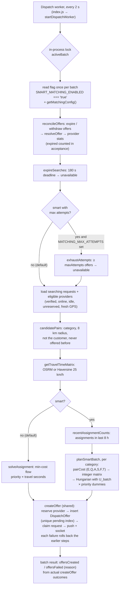

# Smart Matching — Architecture and Data Flow

Scope: `rapidassist/server/`. The smart engine is a **branch inside the existing batch dispatcher**, not a separate service. Eligibility, the 8 km radius (every category, flag on or off), reservations, offers (20 s), the search timeout (180 s), accept/decline, Socket.IO events and recovery are shared by both paths. Only the batch *decision* differs.

## 1. Batch flow



An invalid matching config with the flag on logs one error and runs the existing solver for that batch. Dispatch never stops because of a config typo.

## 2. Modules

| Module | Role | Pure? |
|---|---|---|
| `config/matching.js` | flag check, weights, priors, U, multipliers, batch cap, numeric bound | yes |
| `matching/cost.js` | six penalty terms, `pairCost`, `unmatchedCostsFor` | yes |
| `matching/hungarian.js` | `solveMatrix` (numeric), `assign` (ids + deterministic order) | yes |
| `matching/smartBatch.js` | per-category matrices, caps, integer scaling, safety check, plan with real costs | yes |
| `services/dispatch.js` | DB reads, eligibility, offers, accept/decline, flag branch (`smartMatchingConfig`, `exhaustAttempts`, `recentAssignmentCounts`, `dispatchSmartBatch`) | no |

The pure modules have no DB, clock or I/O access. The dispatcher passes in `now`, the pairs, travel times and workload.

## 3. Offer lifecycle (unchanged by the flag)

1. `createOffer` reserves the provider with a conditional `User.findOneAndUpdate` against the full eligibility query. If that fails, the reason is `provider_unavailable`.
2. It inserts the `DispatchOffer` (`outcome: "offered"`). The unique partial index `one_pending_offer_per_provider` rejects a second pending offer for the provider. That is handled as `duplicate_pending_offer`: the reservation is released, a warning is logged, there is no error response, and the next batch re-plans. The offer is persisted before the request becomes visible as offered, so a duplicate fails before anything is exposed.
3. It claims the request with a conditional `ServiceRequest.findOneAndUpdate` on `status`, `providerId: null`, `dispatch.state: "searching"`, `dispatch.version` and the deadline. If that fails (`request_changed`, for example the request was cancelled mid-batch), the offer record is deleted and the reservation is released.
4. It notifies (push + `request:changed`).
5. The provider polls `GET /api/requests/open`, or reacts to the socket event, and then calls `PATCH /:id/accept {offerId}` or `PATCH /:id/decline {offerId}`.
6. Decline, expiry or the provider going offline sets the request back to `searching`, and the provider is excluded for that request via `attemptedProviderIds`. Only unassigned (`searching`) requests enter the next batch.

## 4. What the flag changes

| | Flag off (default) | Flag on |
|---|---|---|
| Solver | `solveAssignment` (min-cost flow) | Hungarian per category |
| Cost | priority × travel seconds; wait = priority × (2700 s + waited) | `pairCost` ∈ [0,100]; unmatched = U_batch × multiplier |
| Objective | min total flow cost | max matches → max matched priority → min real cost |
| `DispatchOffer.algorithmVersion` | `batch-mincost-v1` | `smart-hungarian-v1` |
| `assignmentCost` | priority × seconds | real pair cost (0–100) |
| `waitingCost` | `waitingCostFor` | `null` (penalties are never stored) |
| `costBreakdown`, `attempt` | absent | E, Q, A, S, F, T, pairCost, weights; attempt number |
| Max attempts | none (search timeout only) | none by default. Opt-in `MATCHING_MAX_ATTEMPTS` ends a search early with the same `unavailable` state and event as the timeout. |
| Batch result | `{assignments (solver plan), unassignedRequestIds, totalCost, batchId, offersCreated, offersFailed}` | `{algorithmVersion, assignments (created offers only, real cost), plannedMatches, offersCreated, offersFailed, unassignedRequestIds, assignedCost, unmatchedCount, categories, batchId}` |

## 5. Flag-independent changes

These changes apply whether `SMART_MATCHING_ENABLED` is on or off. None of them changes **which provider is offered which request**.

| Change | What it does | Why it applies with the flag off |
|---|---|---|
| **`createOffer` order** (Phase 5) | reserve provider → **save offer** (`DispatchOffer`, `outcome: "offered"`) → claim request → notify. Rollback: if the reservation fails, nothing was written (`provider_unavailable`). If saving fails on the pending-offer index, the reservation is released, a warning is logged and the batch re-plans (`duplicate_pending_offer`). If the request claim fails, the saved offer is deleted and the reservation released (`request_changed`). Every batch result reports `offersCreated` / `offersFailed` from these actual outcomes. | Both solvers create offers through the same function. Saving the offer before the request becomes visible as offered means a provider can never see or accept an offer that has no record. The batch result previously listed planned assignments as if they were offers. |
| **Orphan sweep** (Phase 5) | The existing recovery sweep (`recoverReservations`, about every 30 s) marks a pending offer **`withdrawn`** once it is more than 20 s (one offer window) past expiry **and** no longer referenced by its request. Offers still referenced by their request are never touched (`reconcileOffers` owns them). | The unique pending-offer index is flag-independent. An orphan left by an interrupted flow (a crash between steps) would otherwise block its provider from every future offer in either mode. It uses `withdrawn`, not `expired`, so the provider's acceptance statistics are not affected. |
| **`expiredOffers` recording** (Phase 4) | Expired offers refresh `providerPerformance` and are counted in the new `expiredOffers` field. `responseSamples` / `averageResponseSeconds` still use answered offers only. | Statistics are recorded regardless of the flag, so they are already meaningful the day smart matching is switched on. The existing solver reads none of these fields, and its explainability score reads only the unchanged response fields. |
| **Startup index build** (Phase 5) | `ensurePendingOfferIndex()` builds `one_pending_offer_per_provider` after the DB connection. It never throws; on failure it logs a warning with the manual fix (05-schema-api-events.md §3). | "One pending offer per provider" is a dispatch invariant in both modes. The index makes the database enforce what the provider reservation already enforced in application code. |
| **Batch priority order** (Phase 6) | Pending requests are ordered urgent → high → normal, then oldest first, instead of MongoDB's alphabetical string order (urgent → normal → high). | It fixes a latent bug in shared code. It affects only the order of per-request steps before solving (Google pickup refresh, travel-matrix input, diagnostics). Both solvers order their input themselves, so pairings and offer write order are unchanged (shown below). |
| **Extra-work request / approval** (Phase 6) | Each is one conditional `findOneAndUpdate` (status, owner, pending extra work) instead of read-modify-`save()`. A change committed in between → 409 "Request changed. Refresh and try again." | It fixes a lost-update bug in the job lifecycle, unrelated to matching: a cancellation could be overwritten. |
| **Offer response time** (Phase 6) | `resolveOffer` writes outcome, `respondedAt` and `responseSeconds` (computed by MongoDB from `offeredAt`) in one atomic update. | Previously two writes. A crash between them left `responseSeconds = 0`, which skews the response-time statistics in both modes. |
| **Admin explanation text** (Phase 6) | `GET /api/admin/active-jobs` → `matchingDecision.explanation` has a branch for `smart-hungarian-v1` offers (pair cost and terms). The other two branches are worded exactly as before. | Server-side text only. Existing offers are described exactly as before. |

**Verification (flag off):**
- **Golden snapshot** (`server/test/fixtures/dispatch-flag-off-golden.json`). It was recorded from the dispatcher *before* any smart-matching change, and the current code reproduces it byte-for-byte.
  - It was unchanged through Phases 4–5 (SHA-256 `9cd84af4…` throughout).
  - In Phase 6, re-recording after the priority-sort fix gave a byte-identical file (no diff).
  - Phase 6 also found that the fixture's `createdAt` back-dating was silently dropped: Mongoose treats `createdAt` as immutable on `updateOne`. After fixing the fixture helper (raw collection write), the golden was re-recorded **from the HEAD (pre-Phase-4) source** extracted with `git archive`, and the current code reproduces that recording byte-for-byte (SHA-256 `599e29fd…`).
  - Compared with the previous golden, only `waitingCost` / `totalCost` differ, because requests now really waited 5–100 s. Every request → provider pairing, the declined request and all other fields are identical.
- **Existing dispatch tests.** The unmodified HEAD `test/dispatch.test.js` (71 tests) passes 71/71 against the final code. The working-tree copy differs only by 3 lines that build the pending-offer index in its setup, and it passes too, so all pre-existing scenarios also hold with the database constraint in place.

## 6. API and client impact

No routes, request bodies or response shapes changed. Android and Expo Web use the same `/open`, `/:id/accept`, `/:id/decline` and `request:changed` flow through the shared `DispatchProvider.tsx` / `requests.api.ts`. The provider profile JSON gains one additive field, `providerPerformance.expiredOffers`. Neither the mobile app nor the admin panel reads `providerPerformance`.

## 7. Customer-visible end of a search

Every way a search ends without a provider looks the same to the customer: the 180 s timeout, an expiry after the deadline, or the opt-in max attempts. `status` stays `searching_provider` and `dispatch.state` becomes `unavailable`. The mobile app maps that to its existing "no provider" stage with **Retry search** (`mobile-app/src/requests/stages.ts:53`). One `request:changed` event is emitted with `kind: "dispatch"`. No new status or event exists. With max attempts off (the default), a flag-on search lasts exactly as long as today: until the 180 s deadline.

## 8. Logs

With diagnostics enabled (development default, or `DISPATCH_DEBUG=true`), there is one line per category per smart batch:

```
[matching] batch <id> mechanic: 3 request(s), 2 provider(s), planned 2, offers created 2, failed 0, unmatched 1, real pair cost 61.234 (unmatched penalties excluded, U_batch 201)
```

Offer failures log one warning each, for example `provider <id> already has a pending offer; skipped offering request <id>. The next batch re-plans.`, and appear in the batch result's `offersFailed` with their reason.
